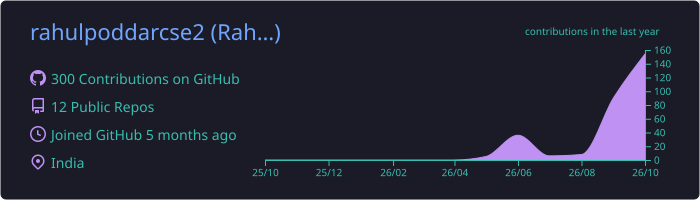
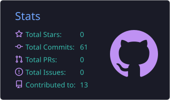
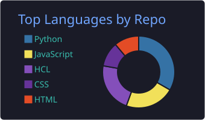
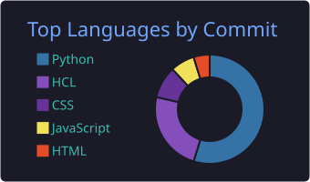

<div align="center">


<a href="https://git.io/typing-svg">
  
</a>

<p>
  <a href="https://www.linkedin.com/in/rahulpoddar-2eab5"></a>
  <a href="mailto:rahulpoddarcse2@gmail.com"></a>
  <a href="https://github.com/rahulpoddarcse2?tab=repositories"></a>
  
  
</p>

<p>
  <b>
  <a href="#about">About</a> ·
  <a href="#experience">Experience</a> ·
  <a href="#skills">Skills</a> ·
  <a href="#projects">Projects</a> ·
  <a href="#learning">Learning</a> ·
  <a href="#stats">Stats</a> ·
  <a href="#contact">Contact</a>
  </b>
</p>

</div>

---

<a id="about"></a>
## 👨‍💻 About Me

I work on **cloud infrastructure, automation, and deployment pipelines**, turning "it works on my machine" into something reproducible, monitored, and safe to hand off to a team.

```text
Code → Build → Test → Containerize → Deploy → Monitor → Improve
```

<details>
<summary><b>📋 Quick facts (click to expand)</b></summary>
<br/>

```yaml
name: Rahul Poddar
location: India
role: Cloud & DevOps Engineer

education:
  degree: BCA
  specialization: Cloud Data Engineering & DevOps

cloud:
  - AWS
  - Microsoft Azure

currently_learning:
  - Kubernetes & Helm
  - GitHub Actions & GitOps
  - Advanced Terraform
  - DevSecOps

availability:
  - Full-time opportunities
  - Immediate joiner
```

</details>

---

<a id="experience"></a>
## 💼 Experience

**DevOps Intern** · DevOps Insider · *Dec 2025 – Present*

Hands-on work with **AWS (EC2, S3) · Docker · Jenkins · GitHub Actions · Terraform · Prometheus · Grafana**

---

<a id="skills"></a>
## 🛠️ Technical Skills

<details open>
<summary><b>☁️ Cloud & Infrastructure</b></summary>
<br/>


</details>

<details open>
<summary><b>🔁 CI/CD & GitOps</b></summary>
<br/>


</details>

<details open>
<summary><b>🐳 Containers & Orchestration</b></summary>
<br/>


</details>

<details open>
<summary><b>📡 Monitoring & Observability</b></summary>
<br/>


</details>

<details open>
<summary><b>💻 Programming & Scripting</b></summary>
<br/>


</details>

---

<a id="projects"></a>
## 🚀 Featured Projects

| Project | Stack | Link |
| :-- | :-- | :-- |
| ☁️ Automated Preview Environments | Terraform · GitHub Actions · AWS · Azure | [Repo](https://github.com/rahulpoddarcse2/automated-preview-environments) |
| ☸️ CI/CD on Kubernetes (Microservices) | Jenkins · Docker · Kubernetes · ArgoCD · Prometheus · Grafana | [App](https://github.com/rahulpoddarcse2/cicd-app-repo) · [GitOps](https://github.com/rahulpoddarcse2/cicd-gitops-repo) |
| 🌦️ Weather Alert Service | Flask · PostgreSQL · Docker · Nginx · GitHub Actions | [Repo](https://github.com/rahulpoddarcse2/weather-alert-service) |
| 🐳 Task Manager Docker Stack | React · Node.js · PostgreSQL · Nginx · Docker | [Repo](https://github.com/rahulpoddarcse2/task-manager-docker) |
| 📊 E-Commerce Executive Dashboard | Python · Pandas · Scikit-learn · Power BI | [Repo](https://github.com/rahulpoddarcse2/ecommerce-executive-dashboard) |

<sub>👇 Click a project below for architecture and key features.</sub>

<details open>
<summary><b>☁️ Automated Preview Environments: Terraform + GitHub Actions</b> (AWS & Azure)</summary>
<br/>

Every open pull request gets its own live, disposable cloud environment, created automatically when the PR opens and destroyed automatically when it's merged or closed.

**Key Features**
- Parameterized Terraform modules for AWS and Azure, sharing one interface
- S3 remote state with DynamoDB locking, one state file per PR
- GitHub Actions workflows for create (`opened`/`synchronize`) and destroy (`closed`)
- Bot comment on the PR with the live preview URL

```text
PR opened → build image → terraform apply → comment preview URL
PR merged/closed → terraform destroy → comment "environment destroyed"
```

</details>

<details>
<summary><b>☸️ CI/CD Integration: Microservices on Kubernetes</b></summary>
<br/>

A three-tier microservices application deployed on Kubernetes through a complete CI/CD + GitOps workflow.

**Key Features**
- Two-repository GitOps architecture (app repo + GitOps repo)
- Jenkins CI pipeline with automated Docker builds and pushes
- ArgoCD-based continuous deployment with self-healing sync
- Prometheus & Grafana monitoring

```text
Developer → GitHub → Jenkins CI → Docker Image → GitOps Repo
    → ArgoCD → Kubernetes → Services/Pods → Prometheus → Grafana
```

</details>

<details>
<summary><b>🌦️ Weather Alert Service</b></summary>
<br/>

Containerized weather-alerting platform with automated CI/CD.

**Key Features**
- Flask backend with background weather polling and email alerts
- Multi-stage, non-root Docker builds with container health checks
- Nginx reverse proxy in front of the app
- GitHub Actions pipeline: test → build → push → deploy

</details>

<details>
<summary><b>🐳 Task Manager: Docker Production Stack</b></summary>
<br/>

Production-oriented three-tier containerized application, orchestrated with Docker Compose.

**Key Features**
- React frontend + Node.js REST API + PostgreSQL, each in its own container
- Nginx reverse proxy, health checks, persistent volumes
- Internal container networking, no ports exposed beyond what's needed

```text
Nginx → React (static)
      → Node.js API → PostgreSQL
```

</details>

<details>
<summary><b>📊 E-Commerce Executive Dashboard</b></summary>
<br/>

End-to-end BI project combining a Python ETL pipeline, customer segmentation, and a Power BI dashboard for business-facing insights.

**Key Features**
- Python ETL: cleaning, transformation, feature engineering
- Customer Lifetime Value analysis + K-Means segmentation
- Star-schema data model feeding a Power BI dashboard

</details>

---

<a id="learning"></a>
## 🏆 Certifications & Learning

| Technology | Focus | Status |
| :-- | :-- | :-- |
| ☁️ AWS | Cloud Practitioner Concepts | 🔄 Learning |
| 🐳 Docker | Production Docker & Compose | ✅ Completed |
| ☸️ Kubernetes | Kubernetes & Helm Fundamentals | 🔄 Learning |
| ⚙️ Terraform | IaC & AWS Provisioning | 🔄 Learning |
| 📊 Power BI | Data Modeling & DAX | ✅ Completed |

---

<a id="stats"></a>
## 📈 GitHub Stats

<div align="center">






<br/><br/>

<picture>
  <source media="(prefers-color-scheme: dark)" srcset="https://raw.githubusercontent.com/rahulpoddarcse2/rahulpoddarcse2/output/github-snake-dark.svg"/>
  <source media="(prefers-color-scheme: light)" srcset="https://raw.githubusercontent.com/rahulpoddarcse2/rahulpoddarcse2/output/github-snake.svg"/>
  
</picture>

<sub>Stats and snake are generated by GitHub Actions and refresh automatically.</sub>

</div>

---

<a id="contact"></a>
## 📫 Let's Connect

<div align="center">

### 💼 Open to Cloud & DevOps opportunities

**Cloud Infrastructure • DevOps • CI/CD • Kubernetes • Terraform • Cloud Automation**

📍 India&nbsp;&nbsp;|&nbsp;&nbsp;🌐 Open to Remote

<br/>

<a href="https://www.linkedin.com/in/rahulpoddar-2eab5"></a>
<a href="mailto:rahulpoddarcse2@gmail.com"></a>

<br/><br/>

*"Automate. Deploy. Monitor. Improve."*

<a href="#about"><sub>⬆ Back to top</sub></a>

</div>
